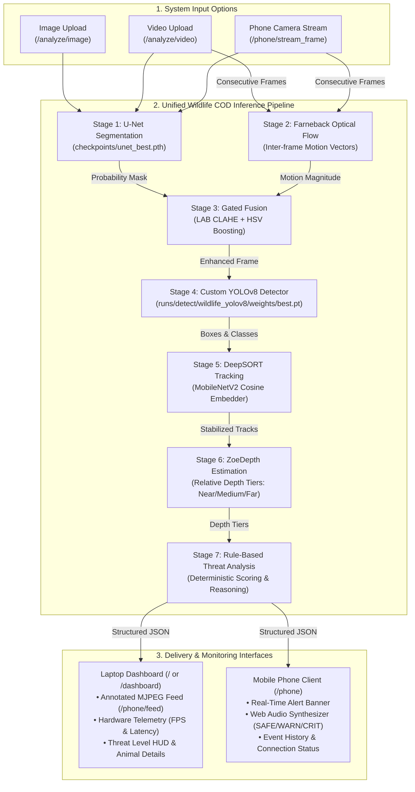

# Real-Time Camouflage-Aware Wildlife Detection and Threat Analysis System

[](https://www.python.org/)
[](https://pytorch.org/)
[](https://flask.palletsprojects.com/)
[](https://docs.ultralytics.com/)
[]()

> **Final-Year Engineering Project — Computer Vision & Machine Learning**  
> **Development Environment:** Windows 11 (64-bit), Python 3.13, PyTorch with CUDA, NVIDIA GeForce RTX 4050 Laptop GPU (6 GB VRAM).  
> **Repository:** [https://github.com/Ashritha0305/COD](https://github.com/Ashritha0305/COD)

---

## Table of Contents

1. [Project Overview and Problem Statement](#1-project-overview-and-problem-statement)
2. [Input Modes and Feature Summary](#2-input-modes-and-feature-summary)
3. [System Architecture and Data Flow](#3-system-architecture-and-data-flow)
4. [Component-by-Component Technical Analysis](#4-component-by-component-technical-analysis)
5. [Technology Stack and Prerequisites](#5-technology-stack-and-prerequisites)
6. [Repository Structure](#6-repository-structure)
7. [Step-by-Step Installation Guide (Windows)](#7-step-by-step-installation-guide-windows)
8. [Operating Modes Detailed Guide](#8-operating-modes-detailed-guide)
9. [HTTPS Configuration and Mobile Camera Access](#9-https-configuration-and-mobile-camera-access)
10. [REST API and Web Route Reference](#10-rest-api-and-web-route-reference)
11. [Dataset, 34 Classes, Training and Evaluation](#11-dataset-34-classes-training-and-evaluation)
12. [Performance and Measured Benchmark Metrics](#12-performance-and-measured-benchmark-metrics)
13. [Audio Alert System and Notification Behavior](#13-audio-alert-system-and-notification-behavior)
14. [Testing and Regression Verification](#14-testing-and-regression-verification)
15. [Comprehensive Troubleshooting Guide](#15-comprehensive-troubleshooting-guide)
16. [Integrating Wildlife COD into Another System](#16-integrating-wildlife-cod-into-another-system)
17. [Security, Privacy and Deployment Limitations](#17-security-privacy-and-deployment-limitations)
18. [Future Improvements](#18-future-improvements)
19. [Academic Documentation and Citations](#19-academic-documentation-and-citations)

---

## 1. Project Overview and Problem Statement

Standard computer vision and object detection models perform poorly when wild animals exhibit natural camouflage. Whether blending into foliage, gravel, snow, or mud, camouflaged wildlife breaks edge boundaries, disrupts color contrast, and deceives generic detectors trained on everyday objects (such as standard COCO detectors).

### The Core Challenges Addressed

1. **Camouflage Contrast Deficit:** Foreground animals often match background luminance and hue, causing generic detectors to miss them completely.
2. **Segmentation vs. Classification Divergence:** Detecting that *something* is camouflaged is not the same as identifying *what species* it is.
3. **Temporal Tracking Continuity:** Animals in motion reveal subtle shear boundaries that disappear when stationary. Tracking must persist across frames without losing target identity.
4. **Spatial and Motion Context:** Threat classification requires spatial depth (relative proximity) and motion velocity, not merely a bounding box.
5. **Deterministic Threat Assessment:** Wildlife risks must be evaluated using auditable, rule-based criteria rather than black-box safety guesses.

### Academic and Research Disclaimer

> [!CAUTION]
> **SAFETY NOTICE:** This application is an **academic and research prototype**, not a certified wildlife safety or perimeter defense product.  
> - Missed detections (false negatives) and species misclassifications (false positives) can and do occur.  
> - A `SAFE` assessment signifies that no predefined high-danger criteria were triggered; it is **never a guarantee** that an outdoor area is free from hazards.  
> - Never approach wild animals based on predictions from this software.

---

## 2. Input Modes and Feature Summary

The application functions as a unified responsive website supporting three distinct operational modes:

| Input Mode | Primary Source | Processing Location | User Interface | Outputs and Feedback |
|---|---|---|---|---|
| **Mode A: Image Upload** | Static file (`.jpg`, `.png`, `.webp`, `.bmp`) | Laptop GPU | Laptop Web Browser (`/`) | 4-panel visual comparison (Original, U-Net Mask, Enhanced + YOLO Detection, ZoeDepth Map), Threat Badge, Latency. |
| **Mode B: Video Upload** | Video file (`.mp4`, `.avi`, `.mkv`) | Laptop GPU | Laptop Web Browser (`/`) | Sequential frame analysis, DeepSORT tracking HUD, overall threat assessment, downloadable annotated MP4. |
| **Mode C: Live Phone Camera** | Rear phone camera via mobile browser (`/phone`) | Laptop GPU (streamed over local Wi-Fi) | Mobile Viewfinder + Laptop Dashboard | Real-time MJPEG feed on laptop dashboard; structured telemetry and Web Audio API threat tones delivered back to phone. |

---

## 3. System Architecture and Data Flow

The project architecture is strictly fixed to a 7-stage sequential pipeline:

**U-Net + Optical Flow → Fusion → custom YOLOv8 → DeepSORT → ZoeDepth → Rule-Based Threat Analysis**



---

## 4. Component-by-Component Technical Analysis

### 4.1 U-Net Camouflage Segmentation
- **Purpose:** Extracts learned binary camouflage foreground probability maps from low-contrast backgrounds.
- **Input:** Single RGB frame resized to 256 x 256 pixels, normalized using ImageNet mean and standard deviation.
- **Output:** Continuous probability map in [0.0, 1.0] representing camouflage likelihood per pixel. Thresholded at `SEG_THRESHOLD = 0.5` for binary masks.
- **Architecture:** 4-level DoubleConv encoder-decoder with base feature width F = 32 (~4M parameters), spatial dropout (`Dropout2d(p=0.2)`), and a Convolutional Block Attention Module (CBAM) at the bottleneck.
- **Implementation File:** [models/unet/unet.py](models/unet/unet.py) and [modules/camouflage_processor.py](modules/camouflage_processor.py).
- **Cadence:** Evaluated on every frame in image mode; evaluated every N = 2 frames (`VIDEO_UNET_INTERVAL`) in video and live streams with temporal mask caching.
- **Limitations:** Cannot classify species. High false-positive rates on complex textured backgrounds such as leaf litter and water ripples.

### 4.2 Farneback Dense Optical Flow
- **Purpose:** Computes inter-frame pixel displacement to extract motion cues that expose moving camouflaged targets.
- **Input:** Consecutive grayscale frames downscaled to 640 x 360 (`OPTICAL_FLOW_WIDTH`, `OPTICAL_FLOW_HEIGHT`).
- **Output:** 2-channel motion displacement vector field (dx, dy) and scalar motion magnitude map normalized to [0.0, 1.0].
- **Parameters:** Pyramid scale 0.5, 3 levels, averaging window 15, 3 iterations, polynomial expansion size 5, Gaussian sigma = 1.2.
- **Implementation File:** [modules/optical_flow.py](modules/optical_flow.py).
- **Cadence:** Executed every frame (`VIDEO_FLOW_INTERVAL = 1`) on consecutive video frames. In image mode, optical flow is bypassed and reports motion as `N/A`.
- **Limitations:** Vulnerable to camera shake. Rapid camera movement elevates motion magnitude across the entire frame.

### 4.3 Gated Camouflage and Motion Fusion
- **Purpose:** Highlights camouflaged animal regions without blowing out image contrast or creating blinding white artifacts.
- **Input:** Original BGR frame, U-Net probability map, and optical flow motion map.
- **Output:** Natural-enhanced BGR frame passed to YOLOv8.
- **Processing Steps:**
  1. *Gating:* Optical flow is gated by U-Net probability: `flow_gated = flow * unet`.
  2. *Attention Map:* Linearly combined: `Attention = 0.7 * unet + 0.3 * flow_gated`.
  3. *Temporal EMA:* Smoothed across frames: `alpha = 0.7`.
  4. *LAB CLAHE:* Contrast Limited Adaptive Histogram Equalization applied to luminance (L-channel, clip limit 2.0).
  5. *HSV Boost:* Saturation boosted up to 25% in the attention region, followed by a gentle 15% luminance lift.
- **Implementation File:** [modules/fusion.py](modules/fusion.py).
- **Cadence:** Operates on every frame.
- **Limitations:** Visual enhancement improves human visibility but does not guarantee an increase in YOLOv8 confidence on every animal class.

### 4.4 Custom YOLOv8 Wildlife Detector
- **Purpose:** Detects bounding boxes and classifies wildlife species across 34 MoCA camouflage categories.
- **Input:** Enhanced BGR frame.
- **Output:** Bounding boxes [xmin, ymin, xmax, ymax], class names, and confidence scores.
- **Checkpoint:** [runs/detect/wildlife_yolov8/weights/best.pt](runs/detect/wildlife_yolov8/weights/best.pt).
- **Thresholds:** Detection threshold `YOLO_CONF_THRESH = 0.15`, NMS IoU threshold `YOLO_IOU_THRESH = 0.45`, unknown threshold `YOLO_UNKNOWN_THRESH = 0.20`.
- **Implementation File:** [modules/detection.py](modules/detection.py).
- **Cadence:** Evaluated every N = 3 frames (`VIDEO_DETECTION_INTERVAL`) in video/stream modes; DeepSORT tracks objects in-between.
- **Limitations:** Low recall on rare single-sequence classes; small or heavily occluded animals can be missed.

### 4.5 DeepSORT Multi-Object Tracking
- **Purpose:** Maintains persistent track IDs, filters transient noise, and stabilizes species labels over time.
- **Input:** YOLOv8 bounding boxes and current video frame.
- **Output:** Confirmed track IDs, tracking persistence (frame count), and bounding box coordinates.
- **Embedder:** `MobileNetV2` deep cosine appearance embedder (`deep_sort_realtime`).
- **Stabilization:** Maintains a 15-frame history window per track and assigns the confidence-weighted majority class.
- **Implementation File:** [modules/tracking.py](modules/tracking.py).
- **Cadence:** Updates on every frame.
- **Limitations:** Rapid panning or long occlusions (>30 frames / `max_age=30`) can trigger track ID switches.

### 4.6 ZoeDepth Relative Depth Estimation
- **Purpose:** Estimates spatial topology to assign relative depth categories to detected targets.
- **Input:** BGR frame resized to 512 x 384.
- **Output:** Normalized float32 relative depth map in [0.0, 1.0] and Inferno-colored visualization.
- **Categories:**
  - Mean Depth < 0.35 => **Near**
  - 0.35 <= Mean Depth < 0.65 => **Medium**
  - Mean Depth >= 0.65 => **Far**
- **Implementation File:** [modules/depth.py](modules/depth.py).
- **Cadence:** Evaluated every N = 5 frames (`VIDEO_DEPTH_INTERVAL`); cached maps reused between intervals.
- **Limitations:** Monocular depth is strictly relative. Uncalibrated metric distances (meters) are disabled to prevent misleading safety claims.

### 4.7 Rule-Based Threat Analysis Engine
- **Purpose:** Evaluates animal risk tier, motion magnitude, tracking persistence, and relative depth to produce an auditable threat status.
- **Input:** Detected species, confidence score, motion level, track persistence, and relative depth.
- **Output:** `ThreatResult` dataclass with `threat_level`, `threat_score`, `reason`, and color formatting.
- **Classification Categories:**
  - `CRITICAL`: High-risk dangerous predator (e.g., `snow_leopard`, `polar_bear`, `snake`, `elephant`) with moderate/high motion, OR any animal with high velocity approaching near.
  - `WARNING`: Medium-risk wildlife (e.g., `boar`, `bison`, `mountain_goat`), OR high-risk animal when stationary, OR unclassified animal with moderate motion.
  - `SAFE`: Low-risk or harmless wildlife (e.g., `crab`, `hedgehog`, `owl`, `grasshopper`) with low motion.
  - `UNKNOWN / LOW CONFIDENCE`: Camouflage foreground detected without confident YOLO classification. Capped below CRITICAL to prevent false panics.
- **Implementation File:** [modules/threat_analysis.py](modules/threat_analysis.py).
- **Cadence:** Evaluated on every frame.

---

## 5. Technology Stack and Prerequisites

### Verified Development Environment
- **Operating System:** Windows 11 Home / Pro (64-bit)
- **Python:** Python 3.13.x (or Python 3.10–3.12)
- **GPU Acceleration:** NVIDIA GeForce RTX 4050 Laptop GPU (6 GB VRAM)
- **CUDA Runtime:** CUDA 12.1 / 12.6 supported
- **PyTorch:** `torch>=2.1.0` with CUDA support

### Dependency Specification

| Package | Minimum Version | Technical Role | Installation Source |
|---|---|---|---|
| `torch` | >= 2.1.0 | GPU deep learning tensor engine | PyTorch official index (`--index-url`) |
| `torchvision` | >= 0.16.0 | Vision models and transformations | PyTorch official index (`--index-url`) |
| `opencv-python` | >= 4.7.0 | Farneback flow, video I/O, CLAHE, drawing | PyPI (`requirements.txt`) |
| `numpy` | >= 1.24.0 | Matrix mathematics, arrays, masking | PyPI (`requirements.txt`) |
| `Pillow` | >= 9.4.0 | Image format decoding (JPEG, PNG, WEBP) | PyPI (`requirements.txt`) |
| `ultralytics` | >= 8.0.0 | Custom YOLOv8 inference and training | PyPI (`requirements.txt`) |
| `deep-sort-realtime` | >= 1.3.0 | Multi-object tracking with appearance embedder | PyPI (`requirements.txt`) |
| `timm` | >= 1.0.0 | MiDaS / ZoeDepth transformer backbone | PyPI (`requirements.txt`) |
| `Flask` | >= 3.0.0 | Web application backend and REST routes | PyPI (`requirements.txt`) |
| `matplotlib` | >= 3.7.0 | Colormaps, plot exports, and metrics | PyPI (`requirements.txt`) |
| `scikit-learn` | >= 1.2.0 | Precision, recall, and evaluation metrics | PyPI (`requirements.txt`) |
| `PyYAML` | >= 6.0 | YOLO dataset configuration parser | PyPI (`requirements.txt`) |
| `tqdm` | >= 4.65.0 | Terminal progress bars | PyPI (`requirements.txt`) |

---

## 6. Repository Structure

```
wildlife_COD/
│
├── app.py                             # Main Flask application, routes, and SSL configuration
├── config.py                          # Centralized parameters, paths, thresholds, and species tiers
├── requirements.txt                   # Production Python package requirements
├── README.md                          # Comprehensive technical documentation
├── yolov8n.pt                         # Base COCO YOLOv8 pretrained checkpoint
│
├── certs/                             # Local SSL certificates (gitignored)
│   ├── wildlife-local.pem             # Local development certificate (with LAN IP SAN)
│   └── wildlife-local-key.pem         # Private key for local HTTPS
│
├── checkpoints/                       # Trained model checkpoints (gitignored)
│   ├── unet_best.pth                  # Best U-Net weights on MoCA (val IoU = 0.2519)
│   └── unet_last.pth                  # Final epoch U-Net checkpoint
│
├── runs/detect/wildlife_yolov8/       # YOLOv8 training and validation runs (gitignored)
│   └── weights/
│       ├── best.pt                    # Best custom 34-class YOLOv8 weights (mAP50 = 48.77%)
│       └── last.pt                    # Final epoch YOLOv8 weights
│
├── models/
│   └── unet/
│       ├── __init__.py
│       └── unet.py                    # U-Net PyTorch architecture (F=32, CBAM, Dropout2d)
│
├── modules/                           # Unified inference pipeline stages
│   ├── __init__.py
│   ├── pipeline.py                    # Master orchestrator & PipelineSession state container
│   ├── camouflage_processor.py        # Combined U-Net + Optical Flow + Fusion manager
│   ├── optical_flow.py                # Farneback dense motion field calculator
│   ├── fusion.py                      # LAB CLAHE + HSV saturation natural fusion
│   ├── detection.py                   # Custom YOLOv8 wildlife detector wrapper
│   ├── tracking.py                    # DeepSORT tracking with temporal class voting
│   ├── depth.py                       # ZoeDepth monocular relative depth wrapper
│   ├── threat_analysis.py             # Deterministic rule-based threat engine
│   ├── phone_stream.py                # Mobile camera ingestion, MJPEG feed, and alert manager
│   └── webcam.py                      # Laptop webcam capture and streaming manager
│
├── templates/                         # Web frontend HTML templates
│   ├── index.html                     # Primary laptop monitoring dashboard
│   └── phone.html                     # Mobile phone camera capture & alert client
│
├── data/                              # Verification sample assets
│   ├── test_image.jpg                 # Sample camouflaged test image
│   └── testvideo.mp4                  # Sample test video sequence
│
├── dataset/                           # Datasets (gitignored, kept locally)
│   ├── MoCA_Video/                    # Raw MoCA video sequences and GT masks
│   └── yolov8_wildlife/               # Converted YOLO-format annotations & data.yaml
│
├── outputs/                           # Generated evaluation reports and artifacts
│   ├── member1_eval/                  # U-Net evaluation metrics (final_metrics.json)
│   ├── yolov8_validation/             # YOLOv8 validation report and PR curves
│   ├── images/                        # Saved outputs from image upload analysis
│   └── videos/                        # Saved outputs from video upload analysis
│
├── scripts/                           # Testing, profiling, and evaluation CLI tools
│   ├── test_unified_pipeline.py       # Canonical 8-test unified pipeline regression suite
│   ├── test_phone_and_live_stream.py  # 6-test suite for phone streaming and alert API
│   ├── test_image.py                  # Standalone CLI image mode test runner
│   ├── test_video.py                  # Standalone CLI video mode test runner
│   ├── profile_pipeline.py            # Fine-grained CUDA-synced video pipeline profiler
│   ├── train_unet.py                  # Full U-Net training pipeline script
│   ├── train_wildlife_yolo.py         # Custom YOLOv8 transfer learning training script
│   └── evaluate_and_report.py         # YOLOv8 evaluation report generator
│
└── uploads/                           # Temporary user upload directory (gitignored)
```

---

## 7. Step-by-Step Installation Guide (Windows)

Follow these copy-and-paste instructions in Windows PowerShell to set up a clean environment:

### Step A: Obtain the Source Code
```powershell
# Clone the repository into your preferred local workspace directory (e.g., ~/projects or workspace/)
git clone https://github.com/Ashritha0305/COD.git
cd COD
```

### Step B: Create and Activate a Virtual Environment
```powershell
# Create an isolated virtual environment named .venv
python -m venv .venv

# Enable script execution for the current session (if blocked by execution policy)
Set-ExecutionPolicy -Scope Process -ExecutionPolicy Bypass

# Activate the virtual environment
.\.venv\Scripts\Activate.ps1
```

### Step C: Install PyTorch with CUDA Support
PyTorch **must** be installed first using the appropriate CUDA wheel:
```powershell
# Upgrade pip
python -m pip install --upgrade pip

# Install PyTorch, torchvision, and torchaudio with CUDA 12.1 support
pip install torch torchvision torchaudio --index-url https://download.pytorch.org/whl/cu121
```

### Step D: Install Project Requirements
```powershell
pip install -r requirements.txt
```

### Step E: Verify GPU Acceleration
Run the following verification command:
```powershell
python -c "import torch; print('PyTorch Version:', torch.__version__); print('CUDA Available:', torch.cuda.is_available()); print('Active Device:', torch.cuda.get_device_name(0) if torch.cuda.is_available() else 'CPU')"
```
*Expected Output:*
```
PyTorch Version: 2.x.x+cu121 (or cu126)
CUDA Available: True
Active Device: NVIDIA GeForce RTX 4050 Laptop GPU
```

### Step F: Obtain and Place Model Checkpoints
> [!IMPORTANT]
> **Checkpoints and .gitignore Rules:**  
> Large deep learning weight files (`*.pt`, `*.pth`) and directory trees (`checkpoints/*`, `runs/`) are explicitly excluded from Git tracking in `.gitignore` to prevent repository bloat. Consequently, **cloning this repository will not provide the trained weights**.  
>  
> Before launching the system, download the required checkpoint assets from your project's GitHub Releases page or artifact storage and place them in the following local directory structure:
>
> 1. **U-Net Camouflage Weights (`unet_best.pth`):**  
>    Place at: `checkpoints/unet_best.pth`  
>    *(Architecture: F=32, CBAM bottleneck, trained on MoCA-Mask sequences, validation IoU = 0.2519)*
> 2. **Custom YOLOv8 Wildlife Weights (`best.pt`):**  
>    Place at: `runs/detect/wildlife_yolov8/weights/best.pt`  
>    *(Fine-tuned 34-class wildlife detector, mAP@50 = 48.77%)*
> 3. **Base COCO Pretrained Checkpoint (`yolov8n.pt`):**  
>    Place at project root: `yolov8n.pt` *(Ultralytics will automatically download this baseline model if missing)*.

Prepare the checkpoint directories and verify file presence in PowerShell:
```powershell
# Create destination directories if they do not exist
New-Item -ItemType Directory -Force -Path checkpoints
New-Item -ItemType Directory -Force -Path runs\detect\wildlife_yolov8\weights

# Verify both required checkpoints exist
Test-Path checkpoints\unet_best.pth
Test-Path runs\detect\wildlife_yolov8\weights\best.pt
```
Both `Test-Path` checks must return `True`. If either weight file is missing, the application will raise a descriptive `FileNotFoundError` during startup.

### Step G: Run Automated Regression Tests
Before launching the web server, verify pipeline integrity:
```powershell
python scripts/test_unified_pipeline.py
python scripts/test_phone_and_live_stream.py
```
Both test suites must report `OK`.

### Step H: Launch the Application
- **Standard HTTP Mode:**
  ```powershell
  python app.py
  ```
- **Secure HTTPS Mode (Recommended for Mobile Phone Camera Access):**
  ```powershell
  python app.py --https
  ```

---

## 8. Operating Modes Detailed Guide

### 8.1 Mode A — Image Upload
1. Open your laptop browser at `http://localhost:5000/` (or `https://localhost:5000/`).
2. Navigate to the **"Image Analysis"** tab.
3. Click **"Choose Image"** and select a file (`.jpg`, `.png`, `.webp`, `.bmp`).
4. Click **"Analyze Image"**.
5. The backend executes `pipeline.process_image()`, producing:
   - **Original Image:** The raw input frame.
   - **U-Net Camouflage Mask:** Highlighted foreground camouflage contours.
   - **Enhanced & Detected:** Natural fusion with YOLOv8 bounding boxes and species tags.
   - **ZoeDepth Map:** Monocular depth map rendered in Inferno colors.
   - **Threat Badge:** Authoritative `SAFE`, `WARNING`, or `CRITICAL` assessment with full reasoning.
6. Processed artifacts are saved to `outputs/images/<session_id>/`.

### 8.2 Mode B — Video Upload
1. Navigate to the **"Video Analysis"** tab on the laptop dashboard.
2. Select a video file (`.mp4`, `.avi`, `.mkv`) and specify maximum frames (default: 60).
3. Click **"Process Video"**.
4. The backend runs the unified canonical pipeline with inference cadences (N_unet = 2, N_yolo = 3, N_depth = 5).
5. Results include:
   - DeepSORT tracking IDs overlaid on targets across frames.
   - Live motion magnitude and relative depth metrics.
   - Downloadable annotated video saved to `outputs/videos/enhanced_<id>.mp4`.

### 8.3 Mode C — Live Phone-Camera Streaming
In this mode, your mobile phone acts as a wireless outdoor camera, while your laptop GPU performs the heavy inference:

```
[Mobile Phone Camera] ──(JPEG / HTTP POST)──> [Laptop GPU (app.py)] ──(MJPEG)──> [Laptop Dashboard]
       ▲                                                 │
       └────────────────(Structured JSON Alerts)─────────┘
```

1. **Start Laptop Server:** Launch `python app.py --https` on the laptop. Note the local network IP displayed in the console (e.g., `https://192.168.0.102:5000`).
2. **Connect Phone:** Connect your phone to the **same Wi-Fi network** as the laptop.
3. **Open Viewfinder:** On your phone browser, open `https://192.168.0.102:5000/phone`.
4. **Grant Permissions:** Allow browser access to the rear camera.
5. **Start Streaming:** Tap **"Start Streaming"**.
6. **Processing Flow:**
   - The phone captures frames via HTML5 canvas throttled to ~5 FPS to prevent network queue lag.
   - Frames are POSTed to `/phone/stream_frame`.
   - The laptop backend feeds frames into `pipeline.process_frame()` using a dedicated `PipelineSession`.
   - The laptop dashboard displays the live annotated feed via `/phone/feed`.
   - Structured alert telemetry is returned to the phone, updating the on-screen HUD and triggering audio alarms on threat escalations.
7. **Stop Streaming:** Tap **"Stop Streaming"** on the phone to release GPU memory and reset tracking state.

---

## 9. HTTPS Configuration and Mobile Camera Access

Modern mobile browsers (Chrome, Safari, Firefox) **mandate a Secure Context** for `navigator.mediaDevices.getUserMedia()`. Accessing an insecure HTTP origin (`http://<LAN-IP>:5000/phone`) over a local Wi-Fi network will cause mobile browsers to disable camera access.

The Flask server provides built-in HTTPS support via `python app.py --https`, loading a local SSL certificate and private key.

### 9.1 Local Certificate Generation via mkcert
To establish a trusted local HTTPS connection across your Wi-Fi network without relying on commercial certificates:

1. Install `mkcert` on your laptop (e.g., via Chocolatey: `choco install mkcert`, or from GitHub releases).
2. Install the local CA authority on your host machine:
   ```powershell
   mkcert -install
   ```
3. Generate local certificates covering `localhost` and your laptop's Wi-Fi LAN IP:
   ```powershell
   # Ensure certs directory exists
   New-Item -ItemType Directory -Force -Path certs

   # Generate certificate and private key (replace 192.168.0.102 with your laptop LAN IP)
   mkcert -cert-file certs\wildlife-local.pem -key-file certs\wildlife-local-key.pem localhost 127.0.0.1 ::1 192.168.0.102
   ```

### 9.2 Installing the Local Root CA on Your Mobile Phone
To enable browser trust on your phone:
1. Locate `rootCA.pem` on your laptop:
   ```powershell
   mkcert -CAROOT
   ```
2. Transfer **strictly the public root CA certificate** (`rootCA.pem`) to your phone (via USB file transfer, email, or local sharing).
3. **Android Installation:** Go to *Settings → Security → Encryption & credentials → Install a certificate → CA certificate*. Select `rootCA.pem` and confirm installation.
4. **iOS Installation:** AirDrop `rootCA.pem`, install the profile in *Settings → Profile Downloaded*, then enable trust in *Settings → General → About → Certificate Trust Settings*.

> [!CAUTION]
> **CRITICAL SECURITY GUARDRAILS:**  
> - **NEVER transfer or share `rootCA-key.pem`.** The private key of your local CA must stay exclusively on your host laptop. Transferring the private key severely compromises the security of any device that trusts the CA.  
> - **Never bypass browser security warnings** or run in insecure origins in production environments.  
> - Both certificate files (`certs/wildlife-local.pem` and `certs/wildlife-local-key.pem`) are excluded by `.gitignore` and must never be committed to Git.  
> - The Flask server enforces pair validation on startup: `app.py --https` verifies that both certificate and private key exist and form a valid TLS pair before binding to `0.0.0.0:5000`. If either file is missing, it terminates immediately with exit code 1.

---

## 10. REST API and Web Route Reference

| Method | Endpoint | Purpose | Request Payload | Response Schema | Concurrency / Error Codes |
|---|---|---|---|---|---|
| `GET` | `/` | Primary laptop monitoring dashboard | None | HTML page (`templates/index.html`) | `200 OK` |
| `GET` | `/phone` | Mobile phone camera capture client | None | HTML page (`templates/phone.html`) | `200 OK` |
| `POST` | `/analyze/image` | Analyzes uploaded static image | `multipart/form-data` with `image` file | `{"status": "success", "elapsed_ms": float, "threat": {...}, "paths": {...}}` | `400` (missing file), `409` (stream active), `500` (error) |
| `POST` | `/analyze/video` | Analyzes uploaded video sequence | `multipart/form-data` with `video` file and `max_frames` | `{"status": "success", "video_url": str, "actual_fps": float, "overall_threat": {...}}` | `400` (missing file), `409` (stream active), `500` (error) |
| `POST` | `/phone/start` | Initializes a live phone stream session | None | `{"status": "success", "session_id": str, "is_active": true}` | `400` (already active), `409` (webcam active) |
| `POST` | `/phone/stop` | Terminates active phone streaming session | JSON `{"session_id": str}` | `{"status": "success", "message": str, "is_active": false}` | `200 OK` |
| `POST` | `/phone/stream_frame` | Ingests a single camera frame from phone | Raw JPEG binary in `request.data` | `{"status": "success", "threat": {...}, "tracked_objects": [...], "alert_event": {...}, "cadence": {...}}` | `400` (empty payload), `409` (webcam active) |
| `GET` | `/phone/feed` | Multipart MJPEG stream for laptop dashboard | None | `multipart/x-mixed-replace; boundary=frame` | `200 OK` continuous stream |
| `GET` | `/phone/telemetry` | Real-time session telemetry dictionary | None | `{"is_active": bool, "fps": float, "latency_ms": float, "threat": {...}}` | `200 OK` |
| `GET` | `/api/network_info` | Returns host LAN IP and pairing URLs | None | `{"primary_ip": str, "phone_url": str, "dashboard_url": str}` | `200 OK` |
| `GET` | `/webcam/devices` | Probes laptop camera indices | None | `{"status": "success", "devices": [int, ...]}` | `200 OK` |
| `POST` | `/webcam/start` | Starts local laptop webcam | JSON `{"camera_index": int}` | `{"status": "success", "camera_index": int}` | `409` (phone active) |
| `POST` | `/webcam/stop` | Stops local laptop webcam | None | `{"status": "success", "is_running": false}` | `200 OK` |
| `GET` | `/webcam/status` | Real-time telemetry metrics and threat analysis for HUD | None | `{"is_running": bool, "fps": float, "latency_ms": float, "threat": {...}}` | `200 OK` |
| `GET` | `/webcam/stream` | Multipart MJPEG stream for laptop webcam | None | `multipart/x-mixed-replace; boundary=frame` | `200 OK` continuous stream |

---

## 11. Dataset, 34 Classes, Training and Evaluation

### 11.1 Dataset Structure (MoCA-Mask)
The models were trained on the **MoCA (Moving Camouflaged Animals)** dataset with pixel-level ground-truth masks:
- **Sequences:** 67 wildlife sequences (~22,939 frames).
- **Split Strategy:** Strict **sequence-level splitting** (zero video frame overlap between training and validation sets) to prevent data leakage.
- **Directory Layout:**
  ```
  dataset/MoCA_Video/TrainDataset_per_sq/<sequence_name>/
  ├── Imgs/     # JPEG color video frames
  └── GT/       # Binary PNG masks (0 = background, 255 = camouflage target)
  ```

### 11.2 The 34 Wildlife Classes

The custom YOLOv8 model classifies the following 34 species:

```
[00] crab                        [12] leaf_tail_gecko           [24] pygmy_seahorse
[01] cuttlefish                  [13] lichen_katydid            [25] rusty_spotted_cat
[02] devil_scorpionfish          [14] markhor                   [26] scorpionfish
[03] eastern_screech_owl         [15] mountain_goat             [27] seal
[04] egyptian_nightjar           [16] nile_monitor              [28] shrimp
[05] elephant                    [17] octopus                   [29] smallfish
[06] flatfish                    [18] orchid_mantis             [30] snow_leopard
[07] flounder                    [19] pallas_cat                [31] sole
[08] grasshopper                 [20] peacock_flounder          [32] spider_tailed_horned_viper
[09] hedgehog                    [21] plaice                    [33] leopard
[10] hermit_crab                 [22] polar_bear
[11] jerboa                      [23] potoo
```

### 11.3 Training and Evaluation Scripts

> [!CAUTION]
> Do not execute training scripts unless you intend to train new weights. The pre-trained checkpoints are verified and operational.

1. **U-Net Camouflage Training:**
   ```powershell
   python scripts/train_unet.py
   ```
   - Uses Tversky loss (alpha = 0.3, beta = 0.7) with Adam optimizer and `ReduceLROnPlateau` on validation IoU.
   - Saves best checkpoint to `checkpoints/unet_best.pth`.
2. **U-Net Evaluation on Validation Split:**
   ```powershell
   python scripts/evaluate_member1.py --checkpoint checkpoints/unet_best.pth
   ```
   - Writes metrics to `outputs/member1_eval/final_metrics.json`.
3. **Custom YOLOv8 Training:**
   ```powershell
   python scripts/train_wildlife_yolo.py
   ```
   - Fine-tunes `yolov8n.pt` on `dataset/yolov8_wildlife/data.yaml` for 25 epochs with batch size 16 at 640 x 640.
   - Saves weights to `runs/detect/wildlife_yolov8/weights/best.pt`.
4. **YOLOv8 Validation Report Generation:**
   ```powershell
   python scripts/evaluate_and_report.py
   ```
   - Generates `outputs/yolov8_validation/yolov8_validation_report.txt`.

---

## 12. Performance and Measured Benchmark Metrics

All metrics reported below are genuine figures verified from local project evaluation artifacts:

### 12.1 Custom YOLOv8 Detection Metrics (`runs/detect/wildlife_yolov8/weights/best.pt`)
*Source: `outputs/yolov8_validation/yolov8_validation_report.txt`*

| Metric | Measured Value |
|---|---|
| **Precision (P)** | **85.33%** |
| **Recall (R)** | **47.46%** |
| **F1-Score** | **60.99%** |
| **mAP@50** | **48.77%** |
| **mAP@50–95** | **36.13%** |

**Top-Performing Classes:**
- `crab`: Precision 97.9%, Recall 100.0%, **mAP50: 99.5%**
- `peacock_flounder`: Precision 98.7%, Recall 100.0%, **mAP50: 99.5%**
- `leopard`: Precision 86.4%, Recall 100.0%, **mAP50: 99.5%**
- `eastern_screech_owl`: Precision 97.7%, Recall 97.4%, **mAP50: 98.8%**
- `flounder`: Precision 90.7%, Recall 92.0%, **mAP50: 95.4%**
- `snow_leopard`: Precision 90.2%, Recall 60.0%, **mAP50: 67.4%**

### 12.2 U-Net Camouflage Segmentation Metrics (`checkpoints/unet_best.pth`)
*Source: `outputs/member1_eval/final_metrics.json`*

| Metric | Measured Value |
|---|---|
| **Intersection over Union (IoU)** | **0.2519** (25.19%) |
| **Dice Coefficient** | **0.3718** (37.18%) |
| **Recall** | **0.6672** (66.72%) |
| **Precision** | **0.3322** (33.22%) |
| **Pixel Accuracy** | **0.8948** (89.48%) |

### 12.3 Hardware Execution Throughput (RTX 4050 GPU)

Execution throughput was evaluated using multiple independent benchmark methods. Each benchmark captures a distinct operational environment and should not be conflated:

| Benchmark Methodology | Script / Route | Conditions & Resolution | Measured Throughput / Latency | Disclosed Overhead / Notes |
|---|---|---|---|---|
| **Static Image Pipeline** | `scripts/test_image.py` | Single 1280x720 frame (`data/test_image.jpg`) | **~1,685 ms** total latency | Includes cold-start model weight loading, CUDA initialization, full 7-stage sequential pass, and 6 visual PNG/JPG disk writes. |
| **Batch Video Processing** | `scripts/test_video.py` | 10 frames of 1280x720 video (`data/testvideo.mp4`) | **2.38 – 2.69 FPS** (~370–420 ms / frame) | Full end-to-end video pipeline with cadence execution, OpenCV frame reading, track visualization, threat HUD overlay, and MP4 re-encoding. |
| **Fine-Grained GPU Profiler** | `scripts/profile_pipeline.py` | 60 frames, intermediate 960x540 resolution | **5.90 FPS steady-state** (169.5 ms mean compute) | Measured with explicit `torch.cuda.synchronize()`; cadence intervals N_unet = 2, N_yolo = 3, N_depth = 5; excludes video container I/O. |
| **Live Phone-Camera Streaming** | `/phone/stream_frame` | Ingested JPEG stream (capped at 960 width) | **~200–250 ms / frame** (**~4.0 – 5.0 FPS**) | Measured via server-side `perf_counter` across local Wi-Fi. Incorporates asynchronous frame-dropping under GPU contention to eliminate network queue lag. |

---

## 13. Audio Alert System and Notification Behavior

The application synthesizes alert tones locally in both the Laptop Dashboard and Mobile Viewfinder using the **Web Audio API**. No external audio files, plugins, or paid services are required.

### 13.1 Audio Tone Profiles

| Threat Tier | Sound Profile | Synthesizer Parameters | Intended Meaning |
|---|---|---|---|
| **SAFE** | Gentle ascending confirmation chime | Sine wave: 523 Hz (C5) -> 659 Hz (E5) | Low-risk wildlife target identified or status confirmed. |
| **WARNING** | Double pulsing caution tone | Triangle wave: 440 Hz (A4) -> 587 Hz (D5) | Moderate-risk wildlife, rapid movement, or unclassified camouflaged targets approaching. |
| **CRITICAL** | Urgent triple alarm sequence | Sawtooth wave: 880 Hz (A5) -> 988 Hz (B5) -> 880 Hz (A5) | High-danger predator detected at `Near` relative depth. |

### 13.2 Safety and Deduplication Guardrails
1. **Transition-Based Triggers:** Audio tones play only when the threat level changes (e.g., SAFE -> WARNING) or when a new target is detected. Sounds are **never spammed on every frame**.
2. **Alert Cooldown:** A 3-second cooldown window suppresses duplicate auditory alarms for the same persistent target.
3. **Mute / Unmute Controls:** Both the laptop dashboard and mobile phone client feature interactive mute buttons with persistent UI state.
4. **Browser Autoplay Compliance:** Modern browsers block audio until user interaction. Audio contexts are initialized only when the user clicks **"Enable Audio"** or **"Start Streaming"**.
5. **Foreground vs. Background Alert Limitations:**  
   - Audio and in-page alert banners operate reliably while the phone browser tab is **active in the foreground**.
   - If the phone browser is minimized or the screen is locked, mobile operating systems suspend Web Audio and JavaScript execution. The system does not guarantee background push notifications unless paired with a Web Push service worker and server daemon.

---

## 14. Testing and Regression Verification

Run the following test commands from the project root in PowerShell:

### 1. Canonical Pipeline Regression Suite
```powershell
python scripts/test_unified_pipeline.py
```
*Verification Coverage:*
- Test 1: Image mode outputs, relative depth, and saved artifacts.
- Test 2: Video mode delegation.
- Test 3: Canonical cadence execution (N_unet = 2, N_yolo = 3, N_depth = 5).
- Test 4: Empty detection fallback (`UNKNOWN / LOW CONFIDENCE`).
- Test 5: Camouflage candidate fallback at measured peak.
- Test 6: Stationary target motion classified as `LOW`.
- Test 7: Temporal state reset across all stages.
- Test 8: Coordinate scaling (sx = 2.0, sy = 2.0).  
*Result:* **`Ran 8 tests in ~21s — OK (All 8 passed)`**

### 2. Phone Stream & Live Alert Integration Suite
```powershell
python scripts/test_phone_and_live_stream.py
```
*Verification Coverage:*
- Test 1: Phone session lifecycle (start, stop, single-session lock).
- Test 2: Ingesting phone frame through canonical engine on GPU.
- Test 3: Alert event trigger and cooldown deduplication.
- Test 4: Multipart MJPEG stream generator (`/phone/feed`).
- Test 5: Concurrency locking (returns HTTP 409 Conflict when busy).
- Test 6: All Flask phone streaming and telemetry endpoints.  
*Result:* **`Ran 6 tests in ~4s — OK (All 6 passed)`**

### 3. Standalone CLI Image Test
```powershell
python scripts/test_image.py --image data/test_image.jpg
```
*Result:* Verifies single-frame execution and writes outputs to `outputs/cli_image_test/`.

### 4. Standalone CLI Video Test
```powershell
python scripts/test_video.py --video data/testvideo.mp4 --max-frames 10
```
*Result:* Verifies sequential frame processing, tracking, and video encoding to `outputs/cli_video_test/enhanced_video.mp4`.

---

## 15. Comprehensive Troubleshooting Guide

| Symptom / Error | Probable Cause | Diagnostic Command | Solution |
|---|---|---|---|
| `ModuleNotFoundError: No module named 'torch'` | Virtual environment not active or PyTorch not installed | `python -c "import torch"` | Activate `.venv` (`.\.venv\Scripts\Activate.ps1`) and install PyTorch via the index URL. |
| `CUDA available: False` | PyTorch installed without CUDA wheel, or GPU driver missing | `nvidia-smi` | Reinstall PyTorch with `--index-url https://download.pytorch.org/whl/cu121`. |
| `torch.cuda.OutOfMemoryError` | GPU VRAM exhausted by high-resolution frame or lingering process | Task Manager -> Performance -> GPU | Lower `INPUT_HEIGHT`/`INPUT_WIDTH` in `config.py` to 256; restart terminal to release zombie Python processes. |
| `FileNotFoundError: checkpoints/unet_best.pth` | Checkpoint missing or path altered | `Test-Path checkpoints\unet_best.pth` | Ensure the trained weights file is placed in `checkpoints/unet_best.pth`. |
| `HTTPS CONFIGURATION ERROR: Missing certificate` | Launching `--https` without generated certificate files | `Test-Path certs\wildlife-local.pem` | Generate certificates via `mkcert` (see Section 9) or run plain HTTP via `python app.py`. |
| `navigator.mediaDevices is undefined` on phone | Mobile browser accessed over insecure HTTP on a remote LAN IP | Check URL scheme on phone | Launch backend with `python app.py --https` and access via `https://<IP>:5000/phone`. |
| Phone cannot reach `https://<IP>:5000/phone` | Devices on different networks or Windows Firewall blocking port 5000 | `Test-NetConnection -ComputerName <IP> -Port 5000` | Ensure phone and laptop are on the same Wi-Fi; allow Python through Windows Defender Firewall. |
| `HTTP 409 Conflict` on upload | Live phone stream or webcam is currently active | Check `/phone/telemetry` or terminal log | Stop the phone or webcam stream before uploading images or videos. |
| Audio alerts not playing on phone or laptop | Browser autoplay restrictions blocking audio context | Inspect browser console for audio warnings | Click **"Start Streaming"** or **"Enable Audio"** to unlock the Web Audio context through user gesture. |
| YOLOv8 outputs `UNKNOWN / LOW CONFIDENCE` | Raw detection confidence below `YOLO_CONF_THRESH` (0.15) | Inspect terminal detection log | The target is camouflaged or unrepresented in the 34 classes; the fallback mechanism correctly handles it as unclassified. |

---

## 16. Integrating Wildlife COD into Another System

To integrate the Wildlife COD inference engine into an external Python application or edge device pipeline:

### 16.1 Reusable Python Interface
You can import and instantiate `WildlifePipeline` directly without running the Flask web server:

```python
import cv2
from modules.pipeline import WildlifePipeline, PipelineSession

# 1. Initialize the complete 7-stage pipeline on GPU
pipeline = WildlifePipeline(
    checkpoint_path="checkpoints/unet_best.pth",
    yolo_weights="runs/detect/wildlife_yolov8/weights/best.pt",
    device="cuda",  # or "cpu"
)

# 2. For single image analysis:
image_results = pipeline.process_image("path/to/image.jpg")
threat = image_results["threat_result"]
print("Threat Level:", threat.threat_level)
print("Animal Class:", threat.animal_class)
print("Confidence:", threat.confidence)
print("Relative Depth:", threat.relative_depth)

# 3. For continuous video or camera stream analysis:
session = PipelineSession()
cap = cv2.VideoCapture(0)

while cap.isOpened():
    ret, frame_bgr = cap.read()
    if not ret:
        break

    # Process frame through canonical engine
    frame_res = pipeline.process_frame(
        frame_bgr=frame_bgr,
        session=session,
        return_viz=True,
    )
    
    threat = frame_res["threat_result"]
    annotated_frame = frame_res["annotated_frame"]
    print(f"Frame {session.frame_idx}: {threat.threat_level} ({threat.animal_class})")

cap.release()
```

### 16.2 REST Integration

External clients can POST JPEG frames to `https://<SERVER_IP>:5000/phone/stream_frame` and consume the structured JSON response:

#### Example A: Classified Wildlife Species Detection
When YOLOv8 confirms a recognized species (e.g., `snow_leopard`), `confidence` represents the **YOLOv8 object detection classification confidence**:

```json
{
  "status": "success",
  "session_id": "a1b2c3d4",
  "frame_idx": 15,
  "elapsed_ms": 218.4,
  "fps": 4.6,
  "threat": {
    "threat_level": "CRITICAL",
    "threat_score": 0.90,
    "animal_class": "snow_leopard",
    "confidence": 0.88,
    "confidence_display": "88.0%",
    "motion_level": "HIGH",
    "relative_depth": "Near",
    "reason": "High-risk apex/large wildlife detected (snow_leopard); High movement detected",
    "depth_note": "Relative Depth Map: AVAILABLE (Calibrated metric distance disabled in current offline prototype)"
  },
  "tracked_objects": [
    {
      "track_id": 1,
      "class_name": "snow_leopard",
      "confidence": 0.88,
      "persistence": 8
    }
  ],
  "cadence": {
    "unet": true,
    "yolo": true,
    "depth": false
  },
  "alert_event": {
    "event_id": "e9b2c1a4",
    "type": "THREAT_ESCALATION",
    "severity": "CRITICAL",
    "title": "THREAT ALERT: CRITICAL",
    "message": "Threat escalated to CRITICAL for snow_leopard. High-risk apex/large wildlife detected (snow_leopard); High movement detected",
    "animal": "snow_leopard",
    "depth": "Near",
    "sound": "CRITICAL",
    "timestamp": "14:23:45"
  },
  "timestamp": "14:23:45"
}
```

#### Example B: Unclassified Camouflaged Entity Detection
When U-Net detects a camouflaged foreground candidate but YOLOv8 cannot confidently classify the species (or species confidence falls below `YOLO_CONF_THRESH`), the system enters the fallback state:

- `animal_class` is designated as `"UNKNOWN / LOW CONFIDENCE"`.
- `confidence` (e.g., `0.80`) represents the **measured U-Net peak camouflage foreground probability**, indicating how strongly the localized pattern breaks edge and background continuity.
- `confidence_display` is explicitly formatted as `"Camo Score: 80.0%"`.
- **CRITICAL DISTINCTION:** This value is **strictly a camouflage probability** from U-Net segmentation. It is **never** a species recognition confidence score.
- Threat level is bounded below `CRITICAL` to prevent false emergency escalations on unverified wildlife.

```json
{
  "status": "success",
  "session_id": "a1b2c3d4",
  "frame_idx": 5,
  "elapsed_ms": 205.1,
  "fps": 4.9,
  "threat": {
    "threat_level": "WARNING",
    "threat_score": 0.40,
    "animal_class": "UNKNOWN / LOW CONFIDENCE",
    "confidence": 0.80,
    "confidence_display": "Camo Score: 80.0%",
    "motion_level": "MODERATE",
    "relative_depth": "Near",
    "reason": "Target identity is unclassified (camouflaged detection / low confidence); species-specific threat rules suspended; MODERATE movement detected in unclassified target (threat capped at WARNING)",
    "depth_note": "Relative Depth Map: AVAILABLE (Calibrated metric distance disabled in current offline prototype)"
  },
  "tracked_objects": [
    {
      "track_id": 1,
      "class_name": "UNKNOWN / LOW CONFIDENCE",
      "confidence": 0.80,
      "persistence": 3
    }
  ],
  "cadence": {
    "unet": true,
    "yolo": false,
    "depth": false
  },
  "alert_event": {
    "event_id": "f8a1c3d2",
    "type": "NEW_TARGET",
    "severity": "WARNING",
    "title": "Target Identified: Camouflaged Target",
    "message": "New wildlife track #1 detected at Near relative depth.",
    "animal": "UNKNOWN / LOW CONFIDENCE",
    "depth": "Near",
    "sound": "WARNING",
    "timestamp": "14:23:45"
  },
  "timestamp": "14:23:45"
}
```

*(Note: When no alert transition or new target trigger occurs on a given frame, `"alert_event"` is `null`).*

---

## 17. Security, Privacy and Deployment Limitations

- **Development Server:** Flask's built-in server is designed for development and local testing. For production deployments, wrap the application with a WSGI server (e.g., `gunicorn -w 1 -b 0.0.0.0:5000 app:app` behind an NGINX reverse proxy).
- **Authentication:** The prototype currently has no user authentication or token-based session verification. Anyone on the local Wi-Fi who knows the port can stream to the server.
- **Data Persistence:** Uploaded files and session frames are saved to `uploads/` and `outputs/`. A production deployment should implement an automated TTL purge daemon.
- **Privacy Notice:** Camera frames transmitted from mobile phones across local Wi-Fi are encrypted only when running with `--https`. Avoid streaming sensitive environments.

---

## 18. Future Improvements

> [!NOTE]
> The items below represent **future research and engineering roadmap opportunities**, and are not claimed as completed features in the current prototype:

1. **Class-Specific Recall Expansion:** Retrain YOLOv8 with focal loss or expanded data for the 20 single-sequence MoCA classes to improve rare species recall.
2. **Metric Distance Calibration:** Calibrate ZoeDepth relative depth using known camera intrinsics and ground-plane homography to enable genuine distance estimation in meters.
3. **Adaptive Camera-Motion Compensation:** Implement affine or homography background motion cancellation before Farneback optical flow to prevent camera pan from triggering motion alarms.
4. **Service Worker Web Push:** Implement a background service worker to deliver push notifications when the mobile browser tab is closed or minimized (currently unsupported; active foreground tab required).
5. **Model Quantization:** Quantize U-Net and YOLOv8 to TensorRT FP16 / INT8 to increase throughput on laptop and edge devices.

---

## 19. Academic Documentation and Citations

If you build upon or reference this project, please cite the foundational architectures and datasets:

- **MoCA Dataset:**  
  Lamdouar, H., Yang, C., Xie, W., & Zisserman, A. (2020). *Betrayed by Motion: Camouflaged Object Discovery via Motion Segmentation*. In Asian Conference on Computer Vision (ACCV).
- **U-Net Architecture:**  
  Ronneberger, O., Fischer, P., & Brox, T. (2015). *U-Net: Convolutional Networks for Biomedical Image Segmentation*. In International Conference on Medical Image Computing and Computer-Assisted Intervention (MICCAI), pp. 234–241.
- **CBAM Attention:**  
  Woo, S., Park, J., Lee, J. Y., & Kweon, I. S. (2018). *CBAM: Convolutional Block Attention Module*. In Proceedings of the European Conference on Computer Vision (ECCV), pp. 3–19.
- **Farneback Optical Flow:**  
  Farnebäck, G. (2003). *Two-Frame Motion Estimation Based on Polynomial Expansion*. In Scandinavian Conference on Image Analysis (SCIA), pp. 363–370. Springer.
- **YOLOv8:**  
  Jocher, G., Chaurasia, A., & Qiu, J. (2023). *Ultralytics YOLOv8*. Version 8.0.0. URL: https://github.com/ultralytics/ultralytics.
- **DeepSORT Tracking:**  
  Wojke, N., Bewley, A., & Paulus, D. (2017). *Simple Online and Realtime Tracking with a Deep Association Metric*. In 2017 IEEE International Conference on Image Processing (ICIP), pp. 3645–3649.
- **ZoeDepth:**  
  Bhat, S. F., Alhashim, I., & Wonka, P. (2023). *ZoeDepth: Zero-shot Transfer by Combining Relative and Metric Depth*. arXiv preprint arXiv:2302.12288.
